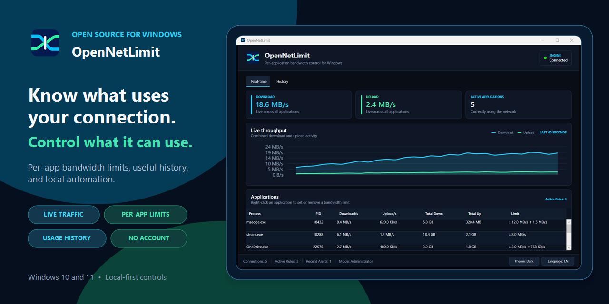
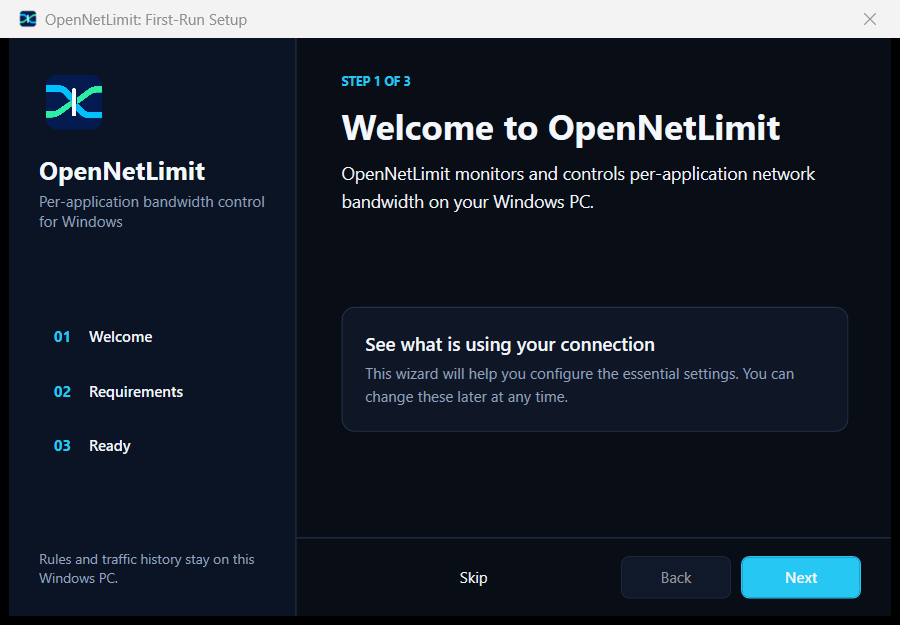
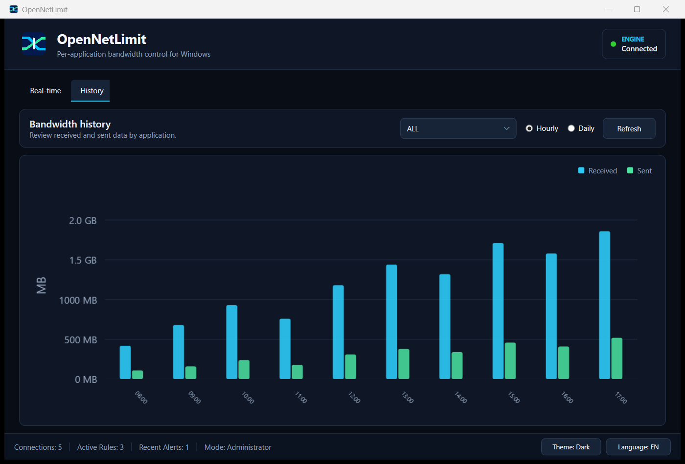
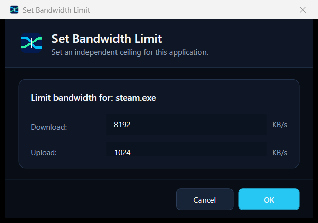
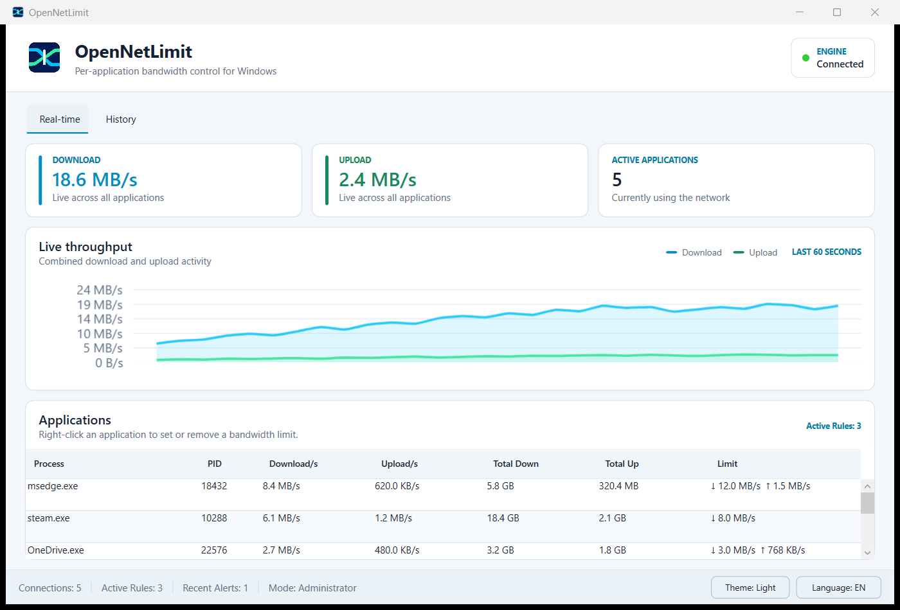

<h1 align="center">OpenNetLimit</h1>

<p align="center"><strong>See which apps use your connection. Set the limits that matter.</strong></p>

<p align="center">
  <a href="https://github.com/SysAdminDoc/OpenNetLimit/releases/latest"></a>
  <a href="LICENSE"></a>
  
  
</p>

<p align="center">
  <a href="https://ko-fi.com/X8K126YVER">
    
  </a>
</p>

<p align="center">
  <sub><em>If this project helps you, a coffee helps me keep working on it.</em></sub>
</p>

<p align="center">
  <a href="https://github.com/SysAdminDoc/OpenNetLimit/releases/latest"><strong>Download for Windows</strong></a>
  ·
  <a href="#quick-start">Quick start</a>
  ·
  <a href="docs/automation-api.md">Automation guide</a>
</p>

OpenNetLimit shows how much bandwidth each Windows app is using and lets you cap or block any of them. It runs locally, keeps traffic history in SQLite and enforces limits through WinDivert.

Use it when a download is wrecking a call or when a background app is chewing through a hotspot allowance. OpenNetLimit shows the culprit and lets you act without replacing your firewall.

## What it does

| Capability | What you get |
|---|---|
| Live traffic | Current download and upload rates for each active process, plus a rolling connection chart |
| Per-app control | Independent download and upload ceilings, blocking rules, wildcard paths, and protocol filters |
| Whole-PC limit | One cap that all apps share, on internet traffic only unless you add the local network |
| Usage history | Hourly or daily charts backed by a local database, with quotas and threshold alerts |
| Repeatable rules | Schedules, app groups, import and export, plus a scriptable command-line client |
| Local automation | A loopback REST API with keyed mutations and an explicit opt-in for remote access |
| Private defaults | Rules and history remain on the PC. VirusTotal, GeoIP, webhooks, and remote access stay off until configured. The once-a-day update check can be switched off |

## Screenshots

| Guided first run | Bandwidth history |
|---|---|
|  |  |

| Focused limit editor | Full light theme |
|---|---|
|  |  |

## Download

Most people want the installer, `OpenNetLimit-v1.1.0-setup-win-x64.exe`. It sets up the service and a Start menu entry. The ZIP holds the same build for running from a folder you pick. Both are self-contained Windows x64 builds, so you don't need to install .NET.

[Download OpenNetLimit 1.1.0](https://github.com/SysAdminDoc/OpenNetLimit/releases/latest)

Every download has a SHA-256 checksum file beside it. Check the file against it if you got it anywhere other than this repository.

Once a day the app asks GitHub whether there's a newer release. When there is, a button in the status bar takes you to it. Nothing gets downloaded. The **Updates** button in the status bar turns the check off, and setting `OPENNETLIMIT_NO_UPDATE_CHECK=1` turns it off for every user on a managed PC.

## Quick start

1. Run the setup exe and accept the administrator prompt.
2. Open OpenNetLimit from the Start menu, or leave the box at the end of setup ticked.
3. Right-click an application in the traffic list to set or remove its limit.

The service starts with Windows. Uninstall it from Settings > Apps like any other program. Your rules and traffic history in `%ProgramData%\OpenNetLimit` stay where they are.

From the ZIP instead: extract it to a permanent folder, run `./Install-Service.ps1` from an Administrator PowerShell window in that folder, then launch `OpenNetLimit.UI.exe`. `./Uninstall-Service.ps1` removes the service.

### Driver trust note

OpenNetLimit loads the signed WinDivert kernel driver, so Windows requires administrator rights for the service. Some security products flag WinDivert because it is a dual-use network driver. Review the [driver trust and enterprise deployment notes](docs/enterprise-driver-deployment.md) before approving it on a managed PC. If antivirus quarantines `WinDivert64.sys`, the service won't start and its error names the folder the file belongs in. Restore it from quarantine, allow it, and restart the service.

## Everyday use

### Limit an application

1. Find the process in the live traffic table.
2. Right-click it and choose **Set Bandwidth Limit**.
3. Enter either limit in KB/s, then select **OK**.

The rule applies right away and keeps applying after the app restarts. OpenNetLimit won't block or limit system-critical Windows processes.

Windows Update, Delivery Optimization and other Windows services run inside `svchost.exe`, so the list shows each svchost with the services in it, like `svchost (BITS)`. A limit on one of those goes on the service, and it follows the service if Windows restarts it in another svchost. When several services share one svchost, the dialog asks which one and names the others the limit will slow too. A svchost running DNS, DHCP, RPC, the firewall, the connection sharing behind Mobile Hotspot and WSL, or another service Windows needs to stay online is never limited, and its row says why.

### Limit the whole PC

The **Whole-PC limit** card on the **Real-time** tab caps every app's traffic added together. Select **Change**, enter the download and upload speeds in KB/s, and select **OK**. A 0 leaves that direction uncapped, and 0 in both turns the limit off.

It only counts internet traffic by default, so copying files to a NAS or another PC at home still runs at full speed. Check **Count local network traffic too** if you want that capped as well. Traffic between programs on the PC itself is never counted, and traffic through a VPN counts once, not again inside the tunnel. Windows Update and other Windows services count toward it too, even the ones that have no limit of their own. Apps and services with their own limit stay under both. Changing it needs the app running as administrator.

### Manage rules and alerts

The **Rules** tab lists every rule the service applies. **Add rule** opens a form where you pick the app by name or full path, or a Windows service by its short name (`BITS`, `DoSvc`, `wuauserv`), then limit or block it. You can keep a rule to certain hours and days, or give it a daily, weekly or monthly data cap that blocks or slows the app once it's used up. The cap keeps counting through restarts and reboots. Turning a rule off keeps it for later, and turning it back on starts its data cap over. **Undo** brings back one you deleted, with the data it had already used.

**Export** saves your rules to a JSON file and **Import** loads one, on this PC or another. Import also reads the `rules.json` the service keeps in `%ProgramData%\OpenNetLimit`, which it saves every time a rule changes. The alerts list under the rules tells you when an app, or every app, goes over a speed you pick. Changing rules or alerts needs the app running as administrator.

### Check traffic history

Open **History**, choose a process or keep **All**, then switch between hourly and daily totals. Data stays in `%ProgramData%\OpenNetLimit\traffic.db`.

### Pause for games

Some kernel anti-cheat systems, Riot Vanguard and Call of Duty's Ricochet among them, won't run while any packet driver is loaded. Right-click the tray icon and choose **Pause for games**. Filtering stops and the WinDivert driver unloads. A notification tells you when nothing from OpenNetLimit is left loaded. If another program has WinDivert open too, the notification names it, and the driver unloads on its own once that program closes. Choose **Resume** when you're done playing. If that other program is still holding the driver, it stays paused and tells you why. Both need the app running as administrator, the same as changing a rule.

A pause ends when the service restarts. Check **Stay paused after restart** to keep it paused through reboots until you resume. Vanguard can still ask for a restart if it saw the driver before you paused. Turn on **Stay paused after restart** first, then restart Windows, and the driver won't load at all.

### Use the command line

```powershell
./onl.exe status
./onl.exe snapshot
./onl.exe rules add --process steam.exe --download 8192 --upload 1024
./onl.exe rules add --service DoSvc --download 1024
./onl.exe stats top --days 7 --limit 10
./onl.exe pc-limit set --download 1024
./onl.exe selftest
./onl.exe pause --stay-paused
./onl.exe resume
```

`selftest` limits the CLI itself for a few seconds and tells you whether the limit held. `pause` exits with code 2 when another program keeps the driver loaded, and says which one. Over REST they're `POST /api/v1/engine/pause?stay=true` and `POST /api/v1/engine/resume`. `pc-limit set` takes KB/s like `rules add`, `--include-lan` counts the local network too, and `pc-limit off` turns it off.

See the [CLI and REST API guide](docs/automation-api.md) for authentication, remote access, and the complete endpoint list.

## Build from source

You need the .NET 10 SDK on Windows.

```powershell
dotnet restore
dotnet build OpenNetLimit.sln -c Release
dotnet test OpenNetLimit.sln -c Release
./scripts/build-release.ps1
```

`build-release.ps1` also builds the installer, which needs [Inno Setup](https://jrsoftware.org/isinfo.php) 6.3 or newer. Pass `-SkipSetup` to build only the ZIP.

To see what the engine costs on your PC, run the loopback benchmark once with the service stopped and once with it running.

```powershell
dotnet run --project tools/OpenNetLimit.Bench -c Release
```

The screenshot script works on separate Windows desktops and never switches away from the one you're using.

```powershell
./scripts/capture-marketing.ps1
```

## How it is put together

| Project | Responsibility |
|---|---|
| `OpenNetLimit.UI` | WPF dashboard, history, rule editing, localization, and theme support |
| `OpenNetLimit.Service` | Background engine, local storage, named-pipe IPC, and REST API |
| `OpenNetLimit.Engine` | WinDivert interception, flow tracking, and packet scheduling |
| `OpenNetLimit.CLI` | Scriptable access to status, rules, history, groups, and quotas |

Persistent state lives in `%ProgramData%\OpenNetLimit`. The UI talks to the service over a local named pipe. Any local user can read from it, and changing rules takes administrator rights.

## Documentation

- [CLI and REST API](docs/automation-api.md)
- [Driver trust and enterprise deployment](docs/enterprise-driver-deployment.md)
- [Third-party notices](THIRD-PARTY-NOTICES.txt)
- [Changelog](CHANGELOG.md)

## Brand archive

Earlier logo and artwork concepts are kept in [`assets/brand/concepts`](assets/brand/concepts), [`assets/marketing/concepts`](assets/marketing/concepts) and [`assets/concepts/2026-09-12-readme-hero`](assets/concepts/2026-09-12-readme-hero). The `selection.json` in the first folder names the approved app icon. Production artwork lives in `assets/brand`, `assets/marketing` and `src/OpenNetLimit.UI/Assets`.

## License

OpenNetLimit is released under the [MIT License](LICENSE). WinDivert and other bundled components retain their own licenses, which are listed in [THIRD-PARTY-NOTICES.txt](THIRD-PARTY-NOTICES.txt).
